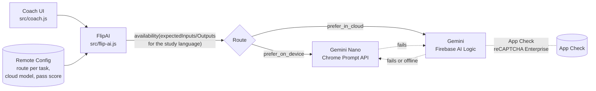

# FlipCards Hybrid AI

**A project management study coach that thinks on your device first and calls the cloud only when it has to.**

FlipCards is a flashcard PWA for 204 project management terms, with original
definitions in nine languages. For **#BuildHybridAI 2026** it gained an AI study coach built on
**Firebase AI Logic hybrid inference**: Chrome's built-in **Gemini Nano** handles the private,
frequent tasks on the device, and **Gemini in the cloud** takes the heavy ones or steps in
whenever the device can't.

- Live app: https://flipcards-hybrid-ai.vercel.app
- Demo video: https://youtu.be/CJWkHQDWqBo
- Platform: Web (desktop Chrome with built-in AI for on-device inference; any modern browser for cloud mode)

## Why hybrid

People preparing for a certification exam explain terms to themselves dozens of times a
day. Those attempts are half-formed and personal, and they should not need a server.

| | On-device (Gemini Nano) | Cloud (Gemini via Firebase AI Logic) |
|---|---|---|
| Privacy | Your typed answer never leaves the device | Only the card and the text for that task are sent |
| Offline | Works on a plane | Needs a connection |
| Cost | Free per call | Metered |
| Strength | Short, structured, frequent tasks | Longer reasoning, scenario writing |

## What the coach does

Open any card while studying and tap **Coach**.

| Tool | What you get | Default route |
|---|---|---|
| **Explain** | Type the term in your own words. You get a 0–100 recall score with what you covered, what you missed and any misconception. A passing score can mark the card as known. | device first |
| **Hint** | A three-step ladder: a nudge and then the key words (both streamed from the model), then a first-letters cloze built locally with no AI at all. | device first |
| **Hook** | A mnemonic, an analogy and a real-project example. | device first |
| **Exam** | A situational question set in a real project, with four shuffled options and an explanation. "Next question" avoids repeats. | cloud first |
| **Compare** | Pick a commonly confused term and get a side-by-side table, a tell-apart tip and an example. | cloud first |

Custom cards you create also get AI definitions through the same engine (device first).

Every answer carries a badge (**On-device · Gemini Nano** or **Cloud · model name**), the
latency, and an "auto-switched" note if it fell back. The profile screen has a **Hybrid AI**
panel showing the device model status (with a Download button), which study languages run on
this device, the routing switch, what runs where, and a privacy ledger counting on-device vs.
cloud calls.

## How the hybrid engine works



- **One model object, two backends.** `getGenerativeModel(ai, { mode, onDeviceParams, inCloudParams })`
  from `firebase/ai`. `result.response.inferenceSource` tells the UI where each answer ran.
- **Routing per task from Remote Config.** `ai_route_grade`, `ai_route_hint`, `ai_route_hook`,
  `ai_route_define` default to `prefer_on_device`; `ai_route_exam` and `ai_route_compare`
  default to `prefer_in_cloud`. `ai_cloud_model` and `ai_pass_score` are also remote, so
  routing and models change without a redeploy.
- **Language-aware.** Each request declares `expectedInputs` / `expectedOutputs` with the
  learner's study language, so Chrome reports whether *that* language can run locally. The
  panel checks all nine study languages; unsupported ones go to the cloud automatically.
- **Real fallback.** If a device-first call throws, FlipAI retries once in the cloud. If a
  cloud-first call fails (offline, quota, network), it retries on the device. Offline in Auto
  mode goes straight to the device.
- **The same structured output on both sides.** One JSON Schema per task is passed as
  `promptOptions.responseConstraint` to Gemini Nano and as `responseSchema` to the cloud model,
  and the result is validated and normalized before it reaches the UI.
- **System prompts that work on-device.** Gemini Nano ignores `systemInstruction`, so the
  engine sends the same instructions through `initialPrompts` with the system role.
- **The learner can override it.** Auto, On-device only or Cloud only, saved locally.
- **Protected cloud access.** Firebase App Check with reCAPTCHA Enterprise in production.
  Local development uses a debug token that lives only in a git-ignored file and is stripped
  from every build.

## Run it locally

Requirements: Node.js 22+, a Firebase project, and desktop Chrome with built-in AI if you
want on-device inference.

1. In the Firebase console, enable **AI Logic** with the Gemini Developer API, register a web
   app, enable **App Check** with a reCAPTCHA Enterprise key for your domain, and (optionally)
   add the Remote Config keys listed above.
2. Install and configure:

   ```sh
   npm install
   cp firebase-config.example.js firebase-config.js   # fill in your web config
   ```

   For localhost, register an App Check debug token in the console and put it in
   `appCheckDebugToken`. Don't add localhost to the reCAPTCHA key.
3. Build and serve:

   ```sh
   npm run build:ai
   npm run dev        # http://127.0.0.1:4173
   ```

4. Test and build for production:

   ```sh
   npm test
   npm run build      # writes dist/ ; config comes from FIREBASE_* env vars when set
   ```

**Getting Gemini Nano.** Use a recent desktop Chrome on a computer that meets
[Chrome's built-in AI requirements](https://developer.chrome.com/docs/ai/get-started),
including plenty of free disk space for the model download. Open **Profile → Hybrid AI** and
press **Download**. Until the model is ready, every task runs in the cloud and the panel says so.

## Try it as a judge

1. Open https://flipcards-hybrid-ai.vercel.app in desktop Chrome. The first visit opens Home.
2. Go to **Profile → Start short session** to open a card, then tap **Coach**.
3. Try **Explain** with a rough answer, climb the **Hint** ladder, make a **Hook**, then run an
   **Exam** question and a **Compare**. Watch the source badge on each answer
   (**On-device · Gemini Nano** or **Cloud**, with its latency).
4. Open **Profile → Hybrid AI** to see device status, per-language routing, and the ledger.
   Tap **Download** to get Gemini Nano if it isn't ready (Chrome needs about 22 GB free on the
   drive that holds your profile). Switch routing to **Cloud only** or **On-device only** and
   repeat a task.
5. With Gemini Nano downloaded, go offline (turn off Wi-Fi): Explain, Hint and Hook keep working.

No account or API key is needed.

## Project structure

```
index.html, styles.css, script.js   the FlipCards app (vanilla JS)
data/standards/                     204 project management terms, original definitions, 9 languages
src/flip-ai.js                      hybrid engine: Firebase AI Logic, App Check, Remote Config
src/coach.js                        coach sheet and Hybrid AI profile panel
src/coach-strings.js                interface copy (en, es)
scripts/build-dist.mjs              production build into dist/
tests/                              node:test suite, including a secret scan
```

## Built during #BuildHybridAI

FlipCards existed before the hackathon. Commit `0c0fcda` in this repository is the May 2026
baseline, so every change since then is visible in the history. On November 27, 2026 the
history was rewritten to take third-party glossary text out of the dataset: earlier
commits keep the terms but show a placeholder instead of each definition, and commit
`7424eeb` adds the original definitions.

**Before (May 2026):** the flashcard app itself: study flow, swipe gestures, cloze practice,
profile and streaks, custom cards and sets, the 204-term glossary in nine languages, and an
optional server endpoint that asked OpenAI for definitions of custom cards.

**Built for the hackathon (November 2026):**

- The hybrid engine `FlipAI` on Firebase AI Logic, with per-task routing, language-aware
  availability checks, two-way fallback, shared JSON schemas and a call ledger.
- Firebase App Check with reCAPTCHA Enterprise, and Remote Config for routes and models.
- The five-tool coach (Explain, Hint, Hook, Exam, Compare) and the Hybrid AI profile panel.
- A narrow bridge between the existing app and the coach (`window.FlipCardsBridge` plus card,
  study and language events).
- Custom-card definitions moved from the OpenAI server endpoint to the hybrid engine. The
  server endpoint, its Netlify and Vercel functions, and the API key were removed.
- English as the default language when the browser is not set to another supported language.
- A new build pipeline (esbuild bundle and generated config), new tests including a secret
  scan, and an updated privacy policy.
- Model text is cleaned to plain text before it reaches the UI, and the grading prompt asks for
  covered and missing ideas taken from the reference definition, with feedback addressed to
  the learner.
- All 204 definitions rewritten in our own words, in English and Spanish, and machine-translated
  again into the other seven languages, so the dataset carries no third-party text.

## Privacy

Progress, cards and settings stay in the browser's local storage. On-device tasks never leave
the device. Cloud tasks send the card term and definition, the text you typed for that task
and your study language to the Gemini API through Firebase AI Logic. There are no accounts,
ads or analytics. Full policy: [privacy.html](privacy.html).

## License

The code is licensed under the Apache License 2.0. See [LICENSE](LICENSE) and [NOTICE](NOTICE).

The definitions of the 204 terms in `data/standards/` are original: they were written for
FlipCards in English and Spanish and machine-translated into the other seven languages. They
are covered by the Apache 2.0 license like the rest of the project.
